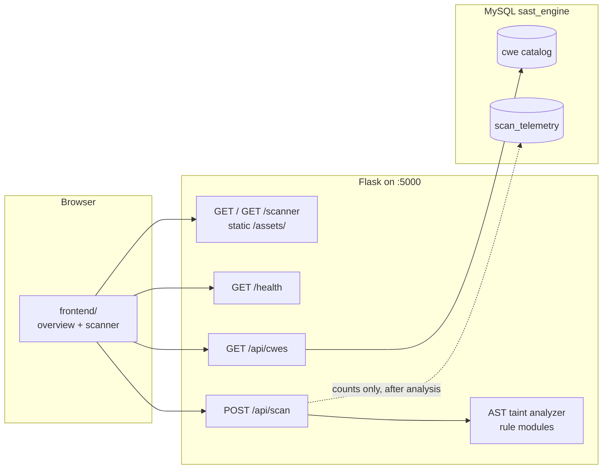
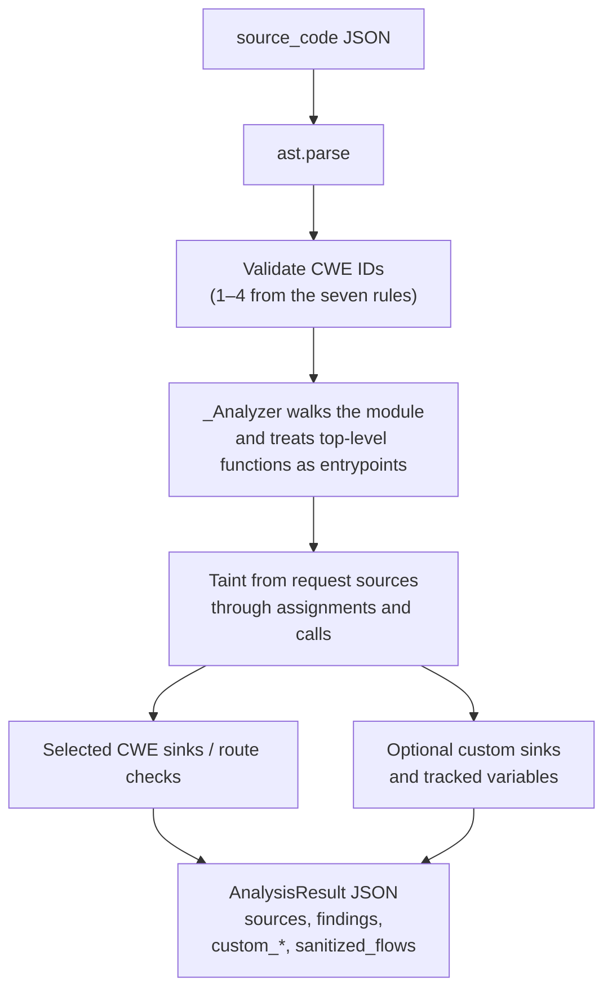

# SAST

SAST is a local static analyzer for Python web code. You paste or upload a module, pick up to four CWEs, and the engine reports tainted flows from request sources to sinks—plus optional custom sinks and tracked variables.

The Flask process is both the API and the web app. Analysis runs in-process from Python’s AST; MySQL is only the CWE catalog and scan-count telemetry. Submitted source is never stored.

## What it checks

| CWE | Weakness |
| --- | --- |
| 78 | OS command injection |
| 79 | Cross-site scripting |
| 89 | SQL injection (default if none selected) |
| 352 | Cross-site request forgery |
| 787 | Out-of-bounds write |
| 862 | Missing authorization |
| 918 | Server-side request forgery |

Rules live in `backend/analyzer/rule_modules/`. They are not loaded from the database. CWE-79 currently treats `escape` and `conditional_escape` as sanitizers; those paths show up as `sanitized_flows` instead of findings.

## System architecture



A scan does not wait on MySQL. If catalog read fails, `GET /api/cwes` returns 503. If telemetry insert fails, the scan response still returns.



### Layout

| Path | Role |
| --- | --- |
| `backend/app/` | Flask factory, routes, MySQL repository |
| `backend/analyzer/` | Parse, taint engine, CWE rule modules |
| `backend/schema.sql` | Database, seed catalog, telemetry table |
| `frontend/` | UI Flask serves at `/` and `/scanner` |
| `frontend-v2/` | Optional React/Vite UI; proxies `/api` and `/health` to Flask. Not served by the backend. |

## Requirements

- Python 3.10 or newer
- MySQL 8.0.16 or newer
- Node.js only if you run `frontend-v2`

## Backend setup

From the repository root:

```powershell
python -m venv .venv
.\.venv\Scripts\Activate.ps1
python -m pip install -r backend\requirements.txt
```

Create the database and seed the catalog:

```powershell
mysql -u root -p
```

At the MySQL prompt, run `SOURCE C:/path/to/SAST/backend/schema.sql;` with the absolute path to this checkout.

Create a least-privilege application account, replacing the sample password:

```sql
CREATE USER 'sast_app'@'127.0.0.1' IDENTIFIED BY 'replace-this-password';
GRANT SELECT ON sast_engine.cwe TO 'sast_app'@'127.0.0.1';
GRANT SELECT ON sast_engine.cwe_list TO 'sast_app'@'127.0.0.1';
GRANT SELECT ON sast_engine.cwe_list_member TO 'sast_app'@'127.0.0.1';
GRANT INSERT ON sast_engine.scan_telemetry TO 'sast_app'@'127.0.0.1';
```

Set environment variables before starting the API (they are not loaded from a file automatically):

| Variable | Default |
| --- | --- |
| `MYSQL_HOST` | `127.0.0.1` |
| `MYSQL_PORT` | `3306` |
| `MYSQL_DATABASE` | `sast_engine` |
| `MYSQL_USER` | `sast_app` |
| `MYSQL_PASSWORD` | empty |
| `MAX_CONTENT_LENGTH` | `3145728` (3 MiB) |
| `HOST` | `127.0.0.1` |
| `PORT` | `5000` |
| `FLASK_DEBUG` | `false` |

```powershell
$env:MYSQL_USER = 'sast_app'
$env:MYSQL_PASSWORD = 'replace-this-password'
python -m backend.run
```

Open `http://127.0.0.1:5000/` or `/scanner`. Static files are under `/assets/`. Monaco loads from jsDelivr; if the CDN is blocked, the page falls back to a textarea.

The browser limits individual `.py` uploads to 1 MiB. Raise `MAX_CONTENT_LENGTH` if you raise that limit.

## API

- `GET /health` — process liveness; does not need MySQL
- `GET /api/cwes` — seven CWE records in catalog order
- `POST /api/scan` — JSON with `source_code`, optional `cwe_ids` (default `[89]`), optional `custom_instructions`

```json
{
  "source_code": "value = request.args.get('q')\\ninternal_query(value)",
  "cwe_ids": [89],
  "custom_instructions": {
    "sinks": ["internal_query"],
    "tracked_variables": ["value"]
  }
}
```

Custom sinks use built-in request sources and appear under `custom_findings`. Tainted assignments to tracked variables appear under `custom_observations`.

## Frontend v2 (optional)

```powershell
cd frontend-v2
npm install
npm run dev
```

Run Flask in another terminal. Vite proxies `/api` and `/health` to `http://127.0.0.1:5000`.
